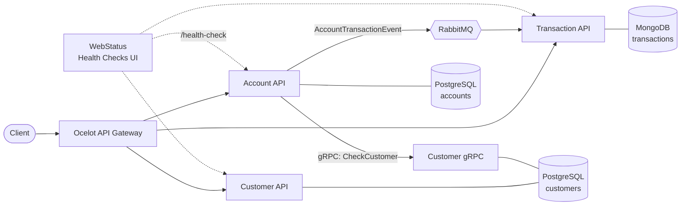

<h1 align="center">Microservices .NET Bank System</h1>

<p align="center">
  A .NET 8 microservices reference project: customers, accounts and transactions, wired together with
  gRPC, RabbitMQ, an Ocelot API gateway and a full observability stack.
</p>

<p align="center">
  <a href="https://github.com/perisicnikola37/microservices-dotnet-bank-system/actions/workflows/ci.yml"></a>
  <a href="LICENSE"></a>
  
  
  
</p>

<p align="center">
  
  
  
  
  
  
  
  
  
</p>

## Table of contents

- [Architecture](#architecture)
- [Services](#services)
- [Quick start](#quick-start)
- [API gateway routes](#api-gateway-routes)
- [Testing](#testing)
- [Project structure](#project-structure)
- [Configuration](#configuration)
- [Contributing](#contributing)
- [License](#license)

## Architecture



- **Synchronous** calls between services use **gRPC** (Account verifies that a customer exists).
- **Asynchronous** communication uses **RabbitMQ** through MassTransit: every deposit or withdrawal publishes an
  event that the Transaction service stores.
- Account and Customer follow **Clean Architecture** with **CQRS** (MediatR) and FluentValidation. Layering rules
  are enforced by architecture tests.

## Services

| Service | Description | Stack | Port |
|---|---|---|---|
| **Account API** | Create accounts, deposit, withdraw | ASP.NET Core, MediatR, EF Core, PostgreSQL | `8001` |
| **Customer API** | Create and read customers | ASP.NET Core, MediatR, EF Core, PostgreSQL | `8002` |
| **Customer gRPC** | Customer existence checks for other services | gRPC | `5001` |
| **Transaction API** | Transaction history (event consumer) | ASP.NET Core, MassTransit, MongoDB | `8003` |
| **Ocelot API Gateway** | Single entry point with caching and rate limiting | Ocelot | `8010` |
| **WebStatus** | Health Checks UI dashboard | ASP.NET Core MVC | `8007` |

Supporting tools: RabbitMQ management (`15672`), pgAdmin (`5050`), mongo-express (`8081`), Portainer (`9000`),
Kibana (`5601`), Elasticsearch (`9200`).

Shared code lives in `src/BuildingBlocks` (`Common.Logging`, `EventBus.Messages`) and
[`ApiVersioningLib`](src/NugetPackage/ApiVersioningLib/README.md) is published as a NuGet package.

## Quick start

**Prerequisites:** [Docker](https://docs.docker.com/get-docker/) with Compose v2. The [.NET 8 SDK](https://dotnet.microsoft.com/download)
is only needed to build or test outside Docker.

```bash
git clone https://github.com/perisicnikola37/microservices-dotnet-bank-system.git
cd microservices-dotnet-bank-system/src

cp .env.example .env          # local credentials, change them if you like
docker compose up -d --build
```

Then open:

| What | URL |
|---|---|
| Gateway | http://localhost:8010 |
| Account Swagger | http://localhost:8001 |
| Customer Swagger | http://localhost:8002 |
| Transaction Swagger | http://localhost:8003/swagger |
| Health dashboard | http://localhost:8007/healthchecks-ui |
| RabbitMQ UI | http://localhost:15672 |

Databases are seeded with sample data on first start. More details are in the
[installation guide](https://github.com/perisicnikola37/microservices-dotnet-bank-system/wiki/Installation-guide).


## API gateway routes

| Method | Gateway path | Downstream |
|---|---|---|
| `POST` | `/accounts` | Account API |
| `GET` | `/accounts/{id}` | Account API |
| `PUT` | `/accounts/{id}/deposit` | Account API |
| `POST` | `/accounts/{id}/withdraw` | Account API |
| `POST` | `/customers` | Customer API |
| `GET` | `/customers/{id}` | Customer API |
| `GET` | `/transactions` | Transaction API |
| `GET` | `/transactions/{accountId}` | Transaction API |

## Testing

```bash
cd src
dotnet test Services/Account/Account.Test/Account.Test.csproj
```

The Account service has unit, integration (EF Core in-memory) and architecture tests (NetArchTest).
CI builds the whole solution, verifies formatting and runs the tests on every pull request.

## Project structure

```text
src/
├── ApiGateways/OcelotApiGateway      # Ocelot gateway
├── BuildingBlocks/
│   ├── Common.Logging                # Serilog + Elasticsearch setup
│   └── EventBus.Messages             # Shared integration events
├── NugetPackage/ApiVersioningLib     # Published NuGet library
├── Services/
│   ├── Account/                      # API / Application / Domain / Infrastructure / Test
│   ├── Customer/                     # API / Application / Domain / Infrastructure / GRPC
│   └── Transaction/Transaction.API   # Event consumer + MongoDB
├── WebApps/WebStatus                 # Health Checks UI
├── scripts/                          # Helper scripts
└── docker-compose.yml
```

Transaction is intentionally a single project: it is a thin read model fed by events, so the extra layers
would add ceremony without value.

## Configuration

Credentials are not stored in `docker-compose.yml`. Copy [`src/.env.example`](src/.env.example) to `src/.env`
and edit it; the file is git-ignored. Service defaults live in each `appsettings.json` and are overridden by
environment variables in Compose (`ConnectionStrings__*`, `EventBusSettings__HostAddress`).

## Contributing

Contributions are welcome. Please read [CONTRIBUTING.md](CONTRIBUTING.md) and the
[Code of Conduct](CODE_OF_CONDUCT.md) first. Security issues: see [SECURITY.md](SECURITY.md).
See [CHANGELOG.md](CHANGELOG.md) for notable changes.

## License

Distributed under the MIT License. See [LICENSE](LICENSE).
